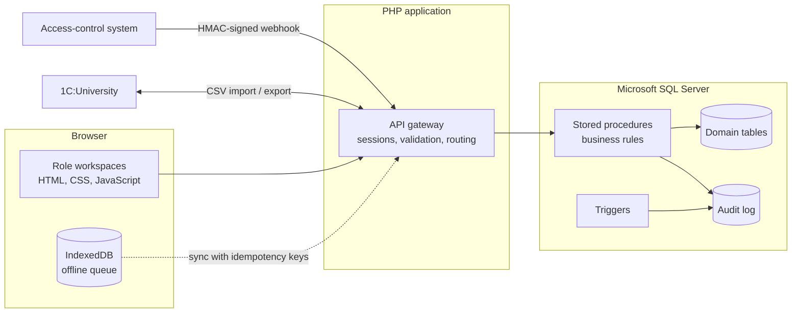

<h1 align="center">Mustafa Fathi</h1>

  <strong>Information Systems Engineer | Software Developer | Systems Analyst</strong>

  I design and build information systems, from analyzing how an organization works 
  to implementing the database, backend, and integrations that automate it.

  <a href="#about">About</a> &nbsp;·&nbsp;
  <a href="#featured-project">Featured Project</a> &nbsp;·&nbsp;
  <a href="#technical-skills">Skills</a> &nbsp;·&nbsp;
  <a href="#engineering-focus">Focus</a> &nbsp;·&nbsp;
  <a href="#contact">Contact</a>

---

## About

I am an Information Systems Engineer focused on systems analysis, software architecture, backend development, and database engineering.

I approach software development from a systems perspective: understanding business requirements, analyzing operational workflows, designing technical solutions, and implementing reliable information systems. This profile is built around one complete project, AIS, rather than a list of claims.

| Discipline | In practice |
|---|---|
| Systems analysis | Mapping operational workflows and the roles involved before choosing a technical approach |
| Requirements engineering | Turning business needs into explicit system rules and integration contracts |
| Software architecture | Deciding where business logic lives and how components and external systems interact |
| Database engineering | Relational schema design, stored procedures, triggers, and indexing in SQL Server |
| Backend development | PHP services for sessions, validation, and integration endpoints |
| Business process automation | Automating recurring academic workflows: attendance capture, absence handling, and reporting |

---

## Featured Project

### AIS: Student Attendance Information System

Developed for **STI NUST MISIS**, a Russian university (Stary Oskol Technological Institute, a branch of the National University of Science and Technology MISIS).

AIS is a web-based attendance management system built with PHP and Microsoft SQL Server. It covers attendance tracking, academic workflow automation, reporting, and integration with existing university infrastructure.

**Business problem.** Attendance has to be captured reliably in the classroom, reported to several different roles, and connected to systems the university already runs, such as 1C:University and physical access control.

**Technical solution.** A thick-database architecture. Business rules live in SQL Server stored procedures and triggers, while PHP handles sessions, request validation, and UI delivery. External systems connect through narrow contracts: CSV files for 1C:University and signed webhooks for access control.

#### Key engineering features

| Area | What it does |
|---|---|
| QR-code attendance | Teachers open QR sessions and students scan them. Sessions are validated and duplicate scans are prevented. |
| Offline recording | Attendance can be recorded offline in the browser using IndexedDB. |
| Idempotent synchronization | Offline records sync using SHA-256 idempotency keys, so a retried submission is not applied twice. |
| Role-based workspaces | Five user roles: administrators, students, teachers, curators, and methodists. |
| Access-control integration | HMAC-secured webhooks accept events from physical access-control systems, with nonce-based replay protection. |
| 1C:University exchange | CSV import and export for groups, students, and attendance data. |
| Database layer | Microsoft SQL Server schema with stored procedures, triggers, and database-level business logic. The scripts define 42 tables, 125 stored procedures, and 17 triggers. |

#### Architecture overview

#### Technology stack

#### Repositories

| Repository | Description |
|---|---|
| [ais-system-en](https://github.com/Mustafafathi/ais-system-en) | English edition: README, architecture notes, and an anonymized public distribution of the system |
| [ais-system-ru](https://github.com/Mustafafathi/ais-system-ru) | Russian edition: delivery package with Russian-language documentation |

I own the system analysis, architecture, database design, and integration model of AIS. AI assistance was used to speed up implementation under my review; the repository documents the split in [AI_COLLABORATION.md](https://github.com/Mustafafathi/ais-system-en/blob/main/AI_COLLABORATION.md).

---

## Technical Skills

Listed technologies are the ones used in AIS.

| Category | Skills |
|---|---|
| Backend Development | PHP 8.2, sqlsrv / PDO_SQLSRV, session handling, role-based access control, HMAC webhook verification, CSV import and export |
| Database Engineering | Microsoft SQL Server, T-SQL, stored procedures, triggers, indexing strategy, audit logging, relational schema design |
| Frontend Development | JavaScript, HTML5, CSS3, IndexedDB for offline storage |
| Systems Analysis | Requirements engineering, operational workflow analysis, role and permission modeling, integration analysis |
| Software Architecture | Thick-database architecture, separation of presentation, transport, and business rules, integration contracts |
| Development Tools | Git, GitHub, automated CI checks |
| Infrastructure | Apache, Windows / XAMPP, Docker Compose for local evaluation |

---

## Engineering Focus

| Focus | Where it shows in AIS |
|---|---|
| Designing information systems | Five role-specific workspaces over one shared data model, from scheduling to reporting |
| Translating business requirements into technical solutions | Absence justification, attendance marking, and reporting workflows expressed as database procedures |
| Database design and optimization | Indexing strategy built around attendance reporting queries |
| Backend business logic | Rules enforced in stored procedures and triggers rather than duplicated in application code |
| System integration | CSV exchange with 1C:University and HMAC-signed webhooks for access control |
| Reliability and data consistency | Duplicate-scan prevention, idempotent offline sync, and audit logging |

---

## Contact

| Channel | Link |
|---|---|
| GitHub | [@Mustafafathi](https://github.com/Mustafafathi) |
| AIS (English) | [ais-system-en](https://github.com/Mustafafathi/ais-system-en) |
| AIS (Russian) | [ais-system-ru](https://github.com/Mustafafathi/ais-system-ru) |
