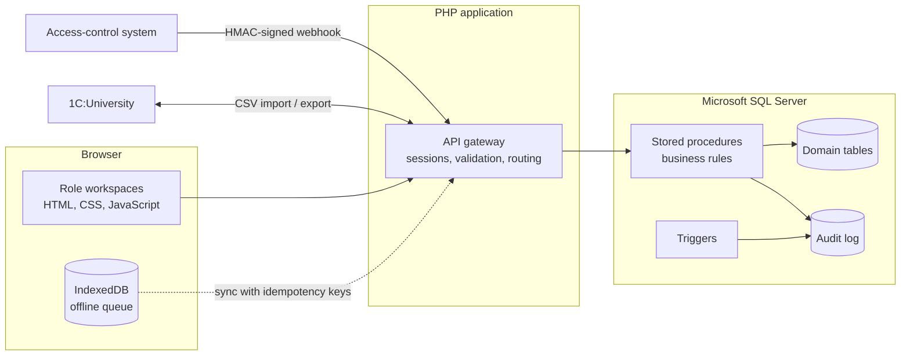

 

---

## About Me

I am an Information Systems Engineer focused on systems analysis, software architecture, backend development, and database engineering.

I approach software development from a systems perspective: understanding business requirements, analyzing operational workflows, designing technical solutions, and implementing reliable information systems.

My engineering interests include:

- Systems Analysis & Requirements Engineering
- Software Architecture & Backend Development
- Database Engineering & Business Logic
- System Integration & Process Automation
- Infrastructure Administration & Reliability

---

## Technical Skills

### Programming Languages

### Database Engineering

### Web Development

### Systems & Development Tools

### Integration & Security

---

## Featured Project

### AIS — Student Attendance Information System

<strong>STI NUST MISIS</strong>

A web-based student attendance management system developed to automate academic attendance workflows, improve data consistency, and integrate with existing university infrastructure.

**Key Engineering Features**

| Component | Implementation |
|---|---|
| Attendance | QR-based session validation |
| Offline Mode | IndexedDB browser storage |
| Synchronization | SHA-256 idempotency keys |
| Authentication | Role-based access control |
| Integration | HMAC-secured webhooks |
| University ERP | CSV exchange with 1C:University |
| Backend | PHP |
| Database | Microsoft SQL Server |

**Database Engineering**

**Source Code**

### Architecture Overview

## Engineering Focus

| Discipline | Practical Application |
|---|---|
| Systems Analysis | Requirements and workflow modeling |
| Software Architecture | Application and database design |
| Backend Engineering | Server-side business logic |
| Database Engineering | Relational modeling and SQL optimization |
| System Integration | Webhooks and external data exchange |
| Reliability | Validation and duplicate prevention |
| Automation | Academic workflow automation |

---

## GitHub Analytics

## Contribution Activity

---

### Engineering reliable systems through analysis, architecture, and implementation.

