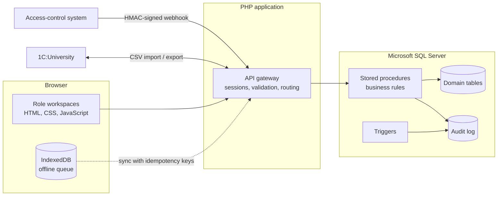

 

**Systems Engineer · Software Developer · Information Systems Analyst**

I design and build information systems, from analyzing how an organization works to implementing the databases, backend services, and integrations that automate its operations.

---

## `01` — About Me

I am an Information Systems Engineer with a focus on systems analysis, software architecture, backend development, and database engineering.

My engineering approach combines business process understanding with technical implementation. I focus on translating operational requirements into structured system designs, reliable data models, and maintainable software solutions.

My work and interests span:

- Systems Analysis & Requirements Engineering
- Software Architecture & Backend Development
- Relational Database Design & Engineering
- Business Process Automation
- API Design & System Integration
- Infrastructure Administration & Troubleshooting
- AI-assisted Software Development

---

## `02` — Technical Skills

### Programming Languages

### Database Engineering

### Web Development

### Runtime & Development Platforms

---

## `03` — Development Environment

### Operating Systems & Virtualization

### Development Environments & IDEs

### Database & Enterprise Tools

### Web Servers & Local Development

### API Testing & System Utilities

---

## `04` — AI-Assisted Engineering

I use AI development tools as part of my engineering workflow for implementation assistance, code analysis, debugging, and technical problem-solving.

### AI Coding Agents & Developer Tools

### AI & Productivity Extensions

---

## `05` — Developer Toolchain

### VS Code Extensions

The following extensions are part of my current development environment:

| Category | Extensions |
|---|---|
| AI Engineering | Claude Code, Continue, Kilo Code, DSCodeGPT, CodeRabbit, ChatGPT |
| PHP Development | PHP Intelephense, PHP Debug (Xdebug) |
| Python Development | Python, Pylance, Python Debugger, Python Environments |
| .NET Development | C# Dev Kit, C#, .NET Install Tool |
| PowerShell | PowerShell Extension |
| Web Development | Live Server, Five Server, Auto Rename Tag, Path Intellisense |
| Code Quality | Prettier, CodeRabbit |
| Configuration | YAML |
| Productivity | Material Icon Theme, Easy Icons, PDF Viewer |

### Python Environment

### JavaScript & Node.js Global Toolchain

---

## `06` — Featured Engineering Project

### AIS — Student Attendance Information System

**STI NUST MISIS | Information Systems Engineering**

A web-based attendance management system designed to automate university attendance workflows, enforce data consistency, and integrate with existing academic and physical access-control infrastructure.

### System Capabilities

| Component | Engineering Implementation |
|---|---|
| QR Attendance | Dynamic session validation and duplicate prevention |
| Offline Processing | IndexedDB-based attendance queue |
| Synchronization | SHA-256 idempotency keys |
| Authentication | Five role-based workspaces |
| Database | Microsoft SQL Server |
| Business Logic | Stored procedures and triggers |
| Access Control | HMAC-secured webhooks and replay protection |
| ERP Integration | CSV exchange with 1C:University |

### Database Engineering

### Architecture Overview

### Source Code

I lead the system analysis, architecture, database design, and integration model. AI-assisted implementation was performed under my specifications and technical review.

See the project's [AI Collaboration Documentation](https://github.com/Mustafafathi/ais-system-en/blob/main/AI_COLLABORATION.md).

---

## `07` — Engineering Interests

| Domain | Focus |
|---|---|
| Systems Engineering | Requirements analysis and architecture |
| Database Engineering | SQL Server and relational data models |
| Backend Engineering | Application logic and integrations |
| Infrastructure | Windows and Linux administration |
| Automation | PowerShell and workflow automation |
| DevOps | CI/CD, deployment, and operational reliability |
| AI Engineering | AI-assisted development and implementation workflows |

---

## `08` — GitHub Analytics

### Contribution Activity

---

**Engineering is not just writing code. It is understanding systems, solving problems, and building reliable solutions.**

